# Capturas de pantalla del Job y del flujo completo

Pantallazos del trabajo final. El documento completo está en `Trabajo_Final_ETL_Electiva.docx`.

## 1. Carpeta del trabajo final en el Workspace

Carpeta ARQUITECTURA_AEROLINEA_TRABAJO FINAL con las subcarpetas Python y Notebook.

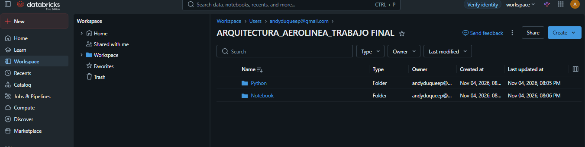

## 2. Ejecución del Job con los archivos .py

Las tres tareas (bronze, silver y gold) en cadena, con estado Succeeded.

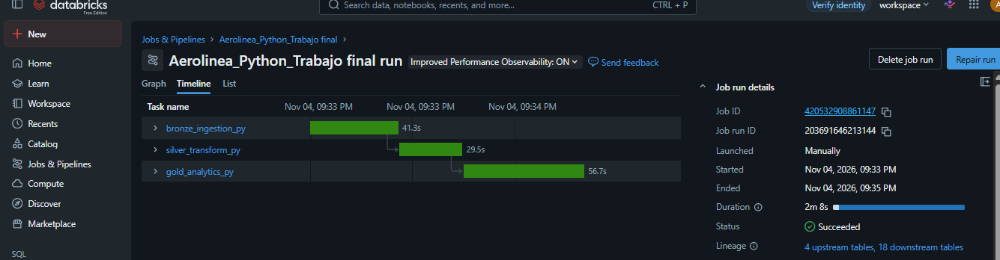

## 3. Notebook de los puntos 1, 2, 3 y 4

Notebooks de preparación, Bronze, Silver, Gold y Machine Learning.

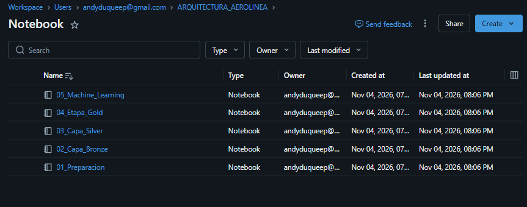

## 4. Jobs & Pipelines del notebook con los puntos 1, 2, 3 y 4

Job con las tareas 01_Preparacion a 04_Capa_Gold y sus ejecuciones exitosas.

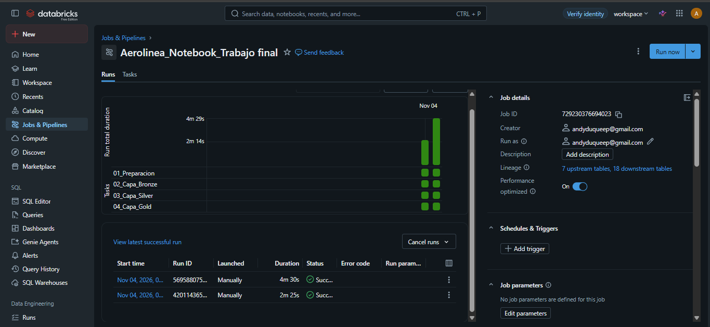

## 5. Ficheros .py de bronce, plata y oro

bronze_ingestion.py, silver_transform.py y gold_analytics.py en el Workspace.

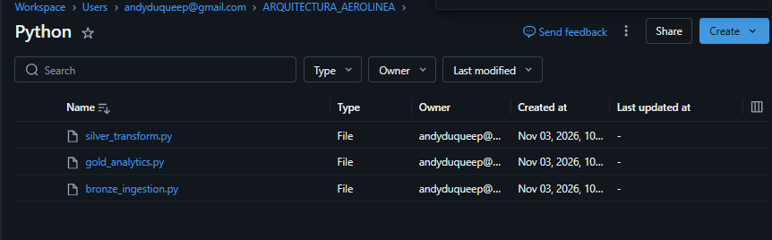

## 6. Jobs & Pipelines de los archivos .py

Se realizan 2 Run para comprobar su funcionamiento.

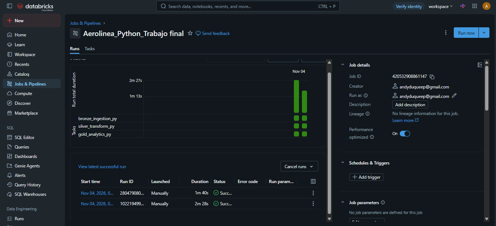

## 7. Archivos .PY y YAML

Los tres scripts y el YAML exportado del Job.

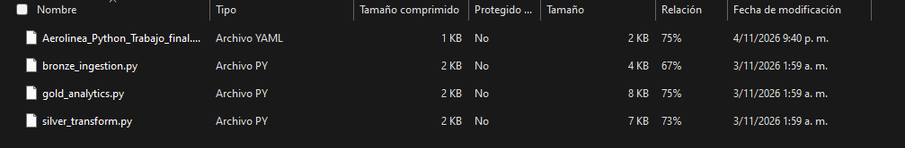

## 8. Orden en Unity Catalog: esquemas

Catálogo aerolinea_trabajo_final con sus esquemas.

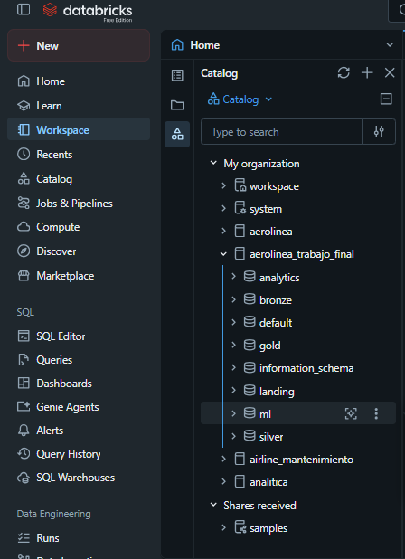

## 9. Orden en Unity Catalog: volumen de carga

Volumen landing.raw_files con los tres CSV.

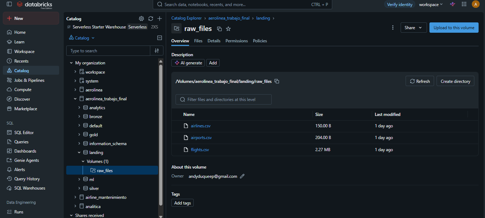

## 10. Orden en Unity Catalog: analytics y bronze

Tablas de los esquemas analytics y bronze.

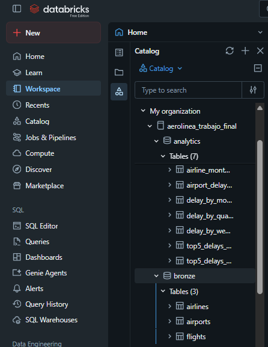

## 11. Orden en Unity Catalog: gold y landing

Tablas de gold y archivos del volumen en landing.

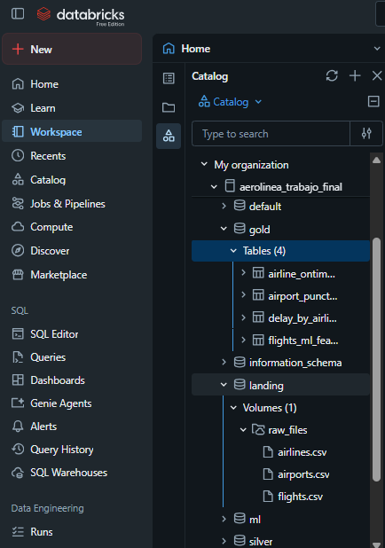

## 12. Notebook y resultados del punto 6 Machine Learning

Notebook 05_Machine_Learning y esquema ml con tablas y modelo registrado.

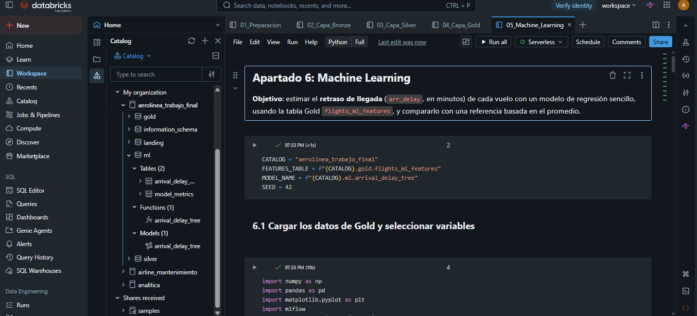

## 13. Notebook y resultados del punto 6 Machine Learning

Métricas de los modelos y predicciones del modelo registrado.

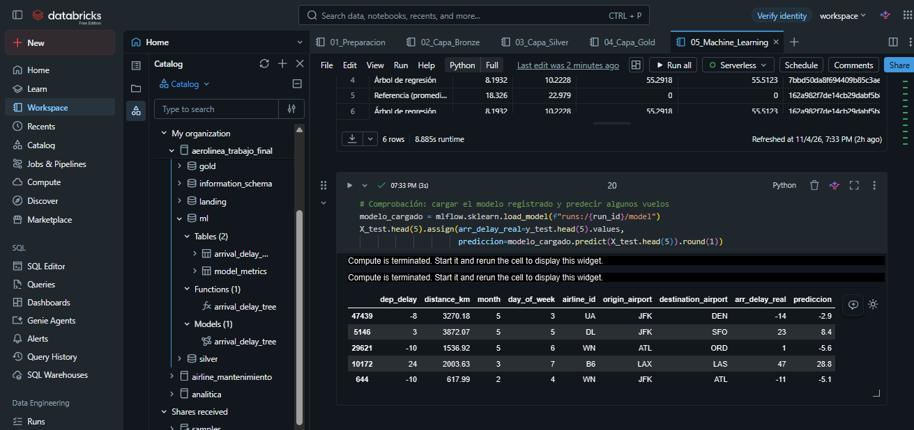

## 14. Notebook y resultados del punto 6 Machine Learning

Esquema ml (tablas, función y modelo) y tablas de silver.

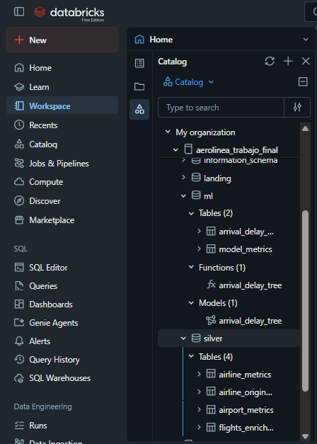
